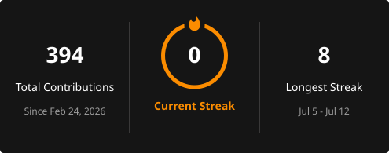

  

  

  <b>IT Student @ VJTI 💻 | Exploring Software Development ✨ | Learning DSA & AI/ML 🌱 | Building Projects & Growing 🚀</b>

## 💫 About Me

- 💻 Interested in software development and building practical applications.
- 🌱 Currently exploring DSA, Python, AI/ML and new technologies.
- 🧩 I enjoy problem-solving and turning ideas into working projects.
- 🚀 Love participating in hackathons and learning through hands-on experiences.
- 🤝 Always open to collaborating, learning and exploring new opportunities!

## 🔭 Currently Working On

- Building practical applications and experimenting with new ideas.
- Strengthening my programming and problem-solving skills.
- Exploring AI/ML and different areas of software development.

## 🛠️ Tech Stack

  

## 📊 GitHub Stats

  
  
  

## 📦 Featured Projects

  
  
  
  

## 🌐 Connect With Me

  
  
  
  
  
  

## ☕ Support My Work

  

